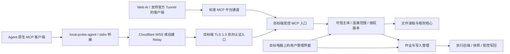
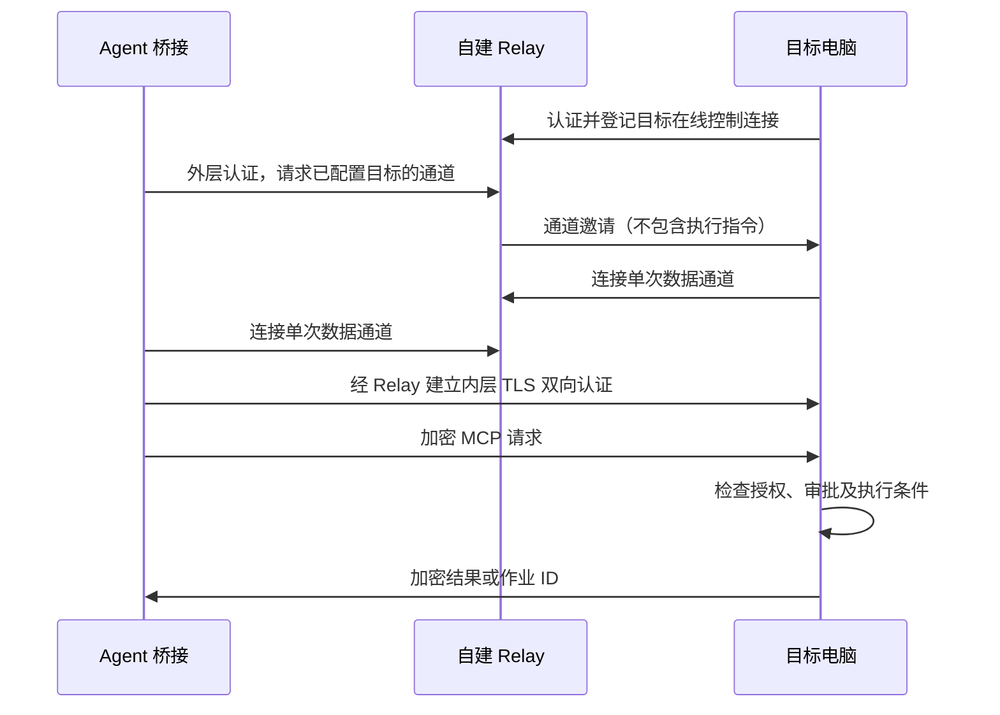

# Local-Probe 双用途与远程操作技术实现书

版本：1.0 · 2026-10-23 · 状态：待执行的开发方案，非功能交付声明。

2026-10-23 执行更新：用户已明确选择允许新增 `trusted_host` 受信任主机执行策略，不再需要等待该产品选择。默认/历史连接仍为 `isolated_required`。详见 [执行安全决策](R12_EXECUTION_DECISION.zh-CN.md) 和 [开发进展](R12_PROGRESS.zh-CN.md)；正文中的待选择描述保留为决策背景，不用于再次请求同一授权。

本方案以当前仓库代码为起点，补齐“Web 访问本地”和“Agent 远程操作”。Agent 远程操作提供 Tunnel 与自建服务器转发两类通道。先交付并验证后端，再接入现有 GUI；不重新设计已经认可的界面。

本次仅新增计划文档。没有安装服务、部署公网服务器、创建账号、更改网络策略、启动命令执行或发布版本。本方案不把之前暂停的严格网络检查视为通过。

## 1. 结论与范围

### 1.1 推荐方案

采用“两个用途、一套权限核心、可替换的传输层”：

1. **Web 访问本地**：Web AI 通过标准 MCP 访问用户授权的目标电脑；保留 OpenAI Secure MCP Tunnel 和 Cloudflare Named Tunnel 接入。
2. **Agent 远程操作**：Agent 通过本机安装的轻量桥接程序访问另一执行环境；支持 Cloudflare Tunnel 与自建 Relay。支持官方 Tunnel 的 OpenAI 客户端还可走标准 MCP 通道。
3. **自建 Relay**：公网服务器负责在线登记、路由、限流和密文字节转发。文件内容、命令、参数和结果在 Agent 桥接程序与目标电脑之间加密，Relay 不持有解密私钥。
4. **权限与通道分离**：选择 Agent 用途不自动授予执行权限；选择 Web 用途也不永久限定只能读。实际能力由目标电脑上的授权配置和执行条件共同决定。
5. **本地原生优先**：Agent 已能在当前环境中合法直接操作目标工作区时，提示使用原生工具；不通过本项目绕过 Agent 的沙箱、审批或文件权限。

### 1.2 本阶段必须交付

继承 [R11 后端优先计划](R11_BACKEND_FIRST_PLAN.zh-CN.md) 中尚未交付的七项能力，不因增加 Relay 而缩水：

| 能力 | 本阶段交付边界 |
|---|---|
| 高级开发者命令运行 | 用户授权的运行器、命令、参数、工作目录与资源限制；真实运行、取消、返回退出状态 |
| 工具版本探查 | 真实探查选定工具，返回可执行文件身份、版本与失败原因；发现安装位置不等于版本已验证 |
| 多连接同时运行 | 多个连接有独立生命周期、权限和作业；一个连接停止不影响其他连接 |
| 高级文件规则 | 在线编辑、预览、版本控制及立即撤权；覆盖读取、搜索、写入、快照与写回 |
| 工作文件写入 | 授权目录内创建、更新及补丁写入；版本冲突和路径越界拒绝 |
| 构建与测试 | 真实执行用户批准的构建/测试流程，管理子进程及输出 |
| 自选脚本 | 用户选择脚本或批准脚本内容、运行器及输入；内容变更重新授权 |

新增双用途、设备身份、Agent 桥接、两类远程通道、端点加密、配对撤销、远程部署与真实跨机验收。

这里的“远程操作”是文件、工具和开发任务操作。本阶段不包括屏幕投送、鼠标键盘控制、RDP、任意端口代理、完整 IDE 或自建 AI 推理服务。

### 1.3 默认假设

- 首个目标端是现有 Windows GUI；Agent 桥接支持 Windows/Linux；Relay 首先交付 Linux amd64，其他平台只在真实验证后声明支持。
- 首版面向一个所有者管理少量可信设备，仍严格隔离不同连接；不承诺企业多租户 SaaS。
- 公网服务器由用户持有或日后选择；当前不假定已经有域名、证书、管理员权限或可用账户套餐。
- 默认只读。开启开发者功能必须指定连接、工作区与具体权限；旧配置不自动升级授权。

## 2. 实际代码基线

以下为本轮源码核对结果，历史测试说明见 [实施状态](IMPLEMENTATION_STATUS.md) 与 [R11 进展](R11_BACKEND_PROGRESS.zh-CN.md)。历史 PASS 不代表本方案已验证。

| 代码位置 | 已有基础 | 需要补建 |
|---|---|---|
| `internal/config/config.go` 的 `Connection` | connection/profile/credential、transport、Tunnel 与端口字段 | 用途、目标设备、授权主体、协议及加密配置引用 |
| `internal/config/transport.go` | `local`、`openai_runtime`、`cloudflare_named` | 新通道配置与合法组合校验；不能把 transport 元数据当身份 |
| `internal/mcpserver/server.go` | 官方 Go SDK；11 个只读工具；按 BoundScope 限制工具 | 设备信息、用途说明、作业及写入工具；按可信授权公开能力 |
| 同文件 `serverInfoOutput` / `handleServerInfo` | 版本、transport、connection/profile/root IDs；返回 `ReadOnly: true` | 目标身份、能力状态与原生访问提示；不能只改 readOnly 标志假装已可执行 |
| `internal/desktopbridge/developer.go` | 开发者配置投影 | 当前仍返回 `network_enforcement_required`，实际执行不可用 |
| `internal/networkguard/wfp/disabled.go` | 禁用实现 | 不提供实际网络 enforcement；不能当作通过的隔离能力 |
| `internal/desktopbridge/service.go` | 单一 `controller` 的桌面生命周期 | 多连接运行实例注册表、资源管理与故障隔离 |
| `readcore`、`rootfs`、`policy` | 读取、路径安全和规则基础 | 写入/快照/在线撤权的一致授权 |
| `config/FileStore`、`workspaceadmin` | 配置 CAS、锁与离线规则管理 | 在线管理事务、配置迁移及回滚 |
| `commandprofile`、`commandexec`、`confirmation`、`probe` | 执行计划、确认及固定探查基础 | 生产执行链、实际运行器与端到端验证 |
| `connectionmanager`、`supervisor`、`admission`、`runtimeowner`、`readiness` | 生命周期和准入组件 | 接入实际多连接宿主，避免并行另造一套协调器 |
| `cfaccess`、`previewconnect`、现有 GUI | 已有接入及操作界面 | 新用途、设备配对、Relay、真实作业状态 |

尚无可交付的自建 Relay、原生 Agent 桥接、端到端配对 PKI。生产命令、写文件、脚本及多连接仍需完成。

当前 `go.mod` 为 Go 1.25.0，官方 MCP Go SDK 为 v1.7.0。执行阶段核对受支持的 Go 工具链及依赖版本后固定构建版本；不在本计划中顺手升级依赖，也不以模块语言版本代替构建工具链版本。

## 3. 产品模型与兼容性

### 3.1 三个独立维度

| 维度 | 值 | 职责 |
|---|---|---|
| 用途 `purpose` | `web_local` / `agent_remote` | 用户意图、引导、工具说明及原生访问提示 |
| 通道 `transport` | 现有官方/Cloudflare 通道；新增 Relay | 网络可达性和外层身份校验 |
| 权限 `grant` | 读、写、探查、命令、构建、脚本 | 在目标端限制实际操作，独立撤销 |

加密配置另用 `security_profile` 表示。不能从用途推断是否加密，也不能从加密成功推断可以执行。

### 3.2 通道矩阵

| 用途与客户端 | 通道 | 是否需要 Agent 桥接 | 加密信任边界 |
|---|---|---|---|
| Web AI | OpenAI Secure MCP Tunnel | 否 | 标准 MCP，经平台处理；不声称对平台隐藏内容 |
| Web AI | Cloudflare Named Tunnel + 现有受控 HTTPS MCP | 否 | HTTPS 保护传输；Cloudflare 终止外层 TLS，不是中间方不可见的端到端加密 |
| 支持官方 Tunnel 的 OpenAI Agent | OpenAI Secure MCP Tunnel | 否 | 标准 MCP；按实际产品权限与能力验收 |
| 可启动本机桥接的 Agent | Cloudflare Named Tunnel 的 WSS 入口 | 是 | WSS 内再运行端点 TLS 1.3；边缘看到密文 |
| 可启动本机桥接的 Agent | 自建 Relay 的 WSS 转发 | 是 | Agent 桥接 ↔ 目标电脑双向 TLS 1.3；Relay 只转发密文 |
| 无法运行桥接的通用云 Agent | 任意自建盲转发 Relay | 不直接支持 | 不能要求普通 MCP 客户端理解项目自定义密文协议 |

最后一种客户端可使用其支持的标准 MCP 服务路径；未来也可增加用户信任的网关，但网关会成为明文终点，必须另行设计，不能沿用“Relay 无法解密”的承诺。

官方 Secure MCP Tunnel 使用出站 HTTPS 拉取并转发 MCP，不是通用 TCP/WebSocket 隧道。其当前默认请求总期限为 120 秒、完整请求/响应封装上限为 10 MiB，且私有 Tunnel 不等于公开插件分发通道。因此长任务采用提交与查询方式，不能依赖一个长 RPC 持续等待。实际权限、关联和限制以接入时核验为准。[官方说明](https://developers.openai.com/api/docs/guides/secure-mcp-tunnels)

### 3.3 同机 Agent 的处理

判定对象是“Agent 当前执行环境是否已具备目标工作区的原生访问能力”，不只是物理电脑是否相同。

- `native_preferred`：安装身份匹配、目标工作区可对应，且原生工具已有合法访问能力；桥接在本地给出原生访问建议，默认不建立不必要的远程数据连接。
- `remote_required`：经配对确认目标是另一环境，或当前环境确实需要跨环境访问；按目标端授权连接。
- `unknown`：无法证明；显示目标设备及工作区，让用户确认，不根据猜测自动运行。

实现使用随机安装 ID、执行环境 ID 和本地受控身份标记；安装 ID 不使用硬件序列号，也不单独作为授权凭据。WSL、容器、虚拟机、SSH/云执行环境分别处理。MCP `clientInfo`、机器名、相同路径和来源 IP 均不能证明同机。

MCP 初始化说明和工具描述统一加入：“目标已在当前环境可用且原生访问获准时，请使用原生工具；不要通过此服务绕过原生权限限制。”该提示是路由建议，不是可靠的客户端封锁机制。仅靠服务端无法识别所有本地 Codex 调用；确需禁止某客户端时，应撤销其连接授权或在客户端取消该插件。

## 4. 总体架构



图中的 B—E 之间建立内层 TLS。T 只承载加密流；标准 MCP 平台通道 P 不包含该自定义加密层。

### 4.1 三个程序的职责

| 程序 | 部署位置 | 职责 | 明确不做 |
|---|---|---|---|
| 现有 Local-Probe 宿主 | 被访问/操作的电脑 | 文件、规则、授权、执行、审批、多连接、审计 | 不把授权交给 Relay 决定 |
| 新 `local-probe-agent` | Agent 实际运行环境 | stdio MCP 入口、目标选择、身份验证、加密通道、断线恢复 | 不自行规划任务、不持有目标端所有者私钥 |
| 新 `local-probe-relay` | 用户公网服务器 | 设备登记、路由配对、连接配额、限流、密文转发 | 不执行命令、不存文件、不做开放代理 |

GUI 不成为必需的网络转发节点；关闭窗口但保留托盘时维持既有宿主语义。真正退出宿主时明确处理连接和作业，不能遗留孤儿进程。首版后台常驻安装作为可选部署，不默认注册系统服务。

### 4.2 复用方式

传输适配器只产出经过验证的主体与字节通道，不直接访问磁盘或启动进程。所有工具共用现有 readcore/policy 及新增 operation 核心。Agent 桥接也用官方 MCP SDK，实现本地 stdio 服务和远端 MCP 客户端，保留取消、错误、能力和通知语义。

先做兼容性样机，验证官方 SDK 能在自定义 `net.Conn` 和 HTTP transport 上正常运行 Streamable HTTP；不自行实现另一套 JSON-RPC/MCP 协议。

## 5. 加密、配对与身份生命周期

### 5.1 两层加密

**外层**：双方通过 HTTPS/WSS 访问公开入口，验证域名证书。Relay 控制接口用独立的短期接入凭据；凭据不能放在 URL 查询串和日志中。

**内层**：Agent 桥接作为 TLS 客户端，目标端作为 TLS 服务端，使用 TLS 1.3 + 双向证书验证。Go 标准库 `crypto/tls` 包装有序的 WSS 字节流；使用标准链校验，再校验预配对的目标身份、证书用途及允许的 Agent 主体。不使用 `InsecureSkipVerify` 绕过正常验证，不设计自己的加密算法。[Go TLS 文档](https://pkg.go.dev/crypto/tls)

TLS 建议固定最低版本 1.3，初版关闭会使撤销处理复杂化的会话恢复；后续启用恢复前必须证明重新执行主体撤销检查。不采用 0-RTT 写操作。

E2EE 保护的是桥接到目标之间的数据。Agent/模型仍会获得它请求的明文结果；不能宣传为模型提供方也不可见。两端被攻陷、用户批准恶意脚本等问题不由传输加密解决。

### 5.2 配对：信任不能由 Relay 自行建立

首版采用目标所有者控制的设备 CA + 显式配对：

1. 目标端生成随机 device ID、独立 CA 密钥和目标 TLS 叶证书。CA 私钥仅供本地管理流程签发，不交给运行工具、远程调用或 Relay。
2. 用户从目标 GUI 导出只含公开身份的配对包：协议版本、device ID、CA/公钥指纹、目标名称与入口信息。通过可信文件传输或当面核对指纹交给 Agent 侧用户。
3. Agent 桥接本地生成私钥和 CSR，将待签发请求交给目标用户；可以由 Relay 中转，但必须核对 CSR 指纹。简单短码只用于定位请求，不能独立建立可信身份。
4. 目标 GUI 展示 Agent 指纹、连接、工作区、权限和有效期。用户确认后签发 Agent 客户端证书，并创建目标端授权记录。
5. Agent 验证收到的证书属于自己的公钥，保存证书和预先核对的目标信任根。Relay 替换包、CSR 或证书时应失败。
6. 首次握手验证目标与 Agent 双方身份；目标再校验主体与 connection/profile 的绑定。

首版配对可用文件往返完成，避免依赖低熵口令自创协议；扫码和简化配对在安全流程稳定后增加。目标电脑重装或根证书改变必须重新核对，不能点一次“重试”就接受新身份。

### 5.3 存储、更新与撤销

- Windows 密钥使用系统凭据保护能力与严格文件 ACL；Linux 首版使用所属用户独占文件权限，明确不等同于硬件密钥库。
- 配置保存 `credential_ref`、`key_ref` 等引用，不保存明文令牌/私钥。禁止将秘密写入插件配置示例、诊断包、审计和源码。
- 叶证书建议 30 天有效期，实际时间可配置。续期要求原有效身份、目标端在线及授权仍有效；过期不能自动信任重签证书。根密钥轮换走独立确认。
- 撤销 Agent：先持久化撤销记录及递增授权版本，再断开会话、清空待执行审批并终止相应作业。即使叶证书尚未过期也拒绝再次接入。
- Relay 接入凭据和目标操作授权分别撤销。Relay 被攻陷后，攻击者最多造成拒绝服务或观察流量元数据，不能自行签发目标信任的操作证书。
- 常规配置备份不包含设备私钥和可复用授权。恢复到新电脑生成新身份并重新配对；专门的密钥灾备需要加密封装、用户口令及明确恢复流程，另设功能。

### 5.4 Relay 能看到什么

Relay 可见随机路由 ID、接入 IP、连接时间、流量大小、在线状态和外层接入主体。不能承诺隐藏这些元数据。文件路径、内容、命令参数、操作结果均置于内层 TLS；设备友好名称也不必上传。

日志只记录必要的连接 ID 摘要、状态、计数和错误码；不持久化数据帧。关闭外层 WebSocket 压缩，设内存上限，避免压缩攻击和不必要的 CPU 开销。

## 6. 传输与协议实现

### 6.1 自建 Relay 数据流

目标与 Agent 均主动向 Relay 发起出站连接，目标不开放公网入站端口：



首版不用自研多路复用协议：每端一个控制 WSS；数据连接按需成对转发，每对绑定一个目标和 Agent。HTTP 请求可复用数据连接，连接池有上限。并发规模验证确有需要后再评估成熟的多路复用库。

WSS 适配器需实现 `net.Conn` 的读取、写入、关闭及 deadline 语义，正确处理消息分片与 TLS 记录边界不一致的情况。初版内层 HTTP 使用明确的 HTTP/1.1 配置，不意外协商尚未实现的 HTTP/2；SSE、取消和背压纳入兼容性测试。

### 6.2 拟新增 Relay API

以下为拟议版本化接口，尚不存在：

| 接口 | 用途 | 限制 |
|---|---|---|
| `GET /healthz` | 进程存活 | 不暴露设备/版本明细及认证信息 |
| `GET /v1/control`（WSS） | 外层认证后登记、心跳与通道邀请 | 每主体限并发；消息严格 schema、大小与速率限制 |
| `POST /v1/channels` | 已授权外层主体申请目标数据通道 | 仅允许注册目标 ID，无任意 host/port/url 参数 |
| `GET /v1/data`（WSS） | 消耗一次性票据，连接成对字节管道 | 票据经认证 header 传递，绑定双方、角色和短有效期 |
| 本地管理 CLI | 发行/撤销 Relay 接入凭据、查看脱敏状态 | 首版不开放公网管理面板 |

票据只保证 Relay 入口准入。即便恶意 Relay 绕过票据，目标仍必须通过内层 TLS 和本地授权拦截。外层控制帧不得出现“执行命令”“批准操作”等高权限语义。

### 6.3 Tunnel 适配

- 官方通道保留现有标准 MCP 路径，通过官方客户端转发；独立 connection/credential 绑定范围。不能把未验证的 HTTP header 当成终端用户身份，也不能由工具参数选择更高权限的 connection。
- Cloudflare Agent 通道新增独立 WSS 路径和端点 TLS 入口，不能复用 Web 明文 MCP 路径冒充 E2EE。入口仍配置外层准入，内层身份是目标操作的最终依据。
- 使用 Cloudflare 时，不把服务令牌发送到模型可见参数中；凭据由桥接进程安全加载。
- Cloudflare 官方文档提示 WebSocket 可能因基础设施更新中断，因此所有适配器都有心跳、重连和状态恢复，不能把持久连接当作永久在线保证。[官方 WebSocket 说明](https://developers.cloudflare.com/network/websockets/)

### 6.4 初始资源预算

以下是实现和压测起点，不是实测性能承诺；最终值写入配置 schema 和测试：

| 项目 | 初始值/策略 |
|---|---|
| 控制消息上限 | 16 KiB，拒绝未知类型及过深结构 |
| 外层数据帧 | 最大 64 KiB，可分片传输，按字节流处理 |
| TLS 握手超时 | 10 秒；失败关闭双方通道 |
| 单次数据票据有效期 | 30 秒、一次性 |
| 心跳 / 离线判定 | 20 秒心跳，约 60 秒无响应判离线 |
| 重连 | 指数退避加随机抖动，1–30 秒；不无界堆积请求 |
| 数据通道 | 每对端初始最多 4 条，每设备总计 16 条，可配置 |
| 单向转发缓冲 | 每通道最多 256 KiB；慢端触发背压 |
| 文件/输出单页 | 原始内容建议最多 256 KiB；另外检查 JSON 编码后的完整消息上限 |
| 执行并发 | 每连接 1 个、目标设备全局 2 个起步，可按后端能力调整 |
| 作业默认超时 | 10 分钟；用户批准的任务可设置更长的有界时限 |
| 输出保存 | 单作业最多 10 MiB、默认 24 小时；达到上限明确截断 |

限额同时按 IP、外层身份、目标设备和全局施加，防止创建大量小通道绕过单通道限制。拒绝新工作时返回可区分的错误，不牺牲其他连接的控制心跳。

## 7. 远程操作核心

### 7.1 工具与数据契约

保留原有只读工具名和行为。新增工具名在执行阶段结合现有契约冻结，以下为职责建议：

| 工具/接口 | 职责 |
|---|---|
| `server_info` 扩展 | target identity、purpose、可用能力、禁用原因和原生访问建议 |
| `probe_tools` | 实际运行受限版本探查，区分 installed / verified / unavailable |
| `prepare_operation` | 校验并生成不可变操作计划和摘要，不产生用户文件副作用 |
| `submit_operation` | 使用目标端已授予的审批执行；返回持久化 operation ID |
| `operation_status` / `operation_output` | 状态与分页输出；游标绑定主体、连接、作业和授权版本 |
| `cancel_operation` | 取消授权范围内的作业，并等待子进程树清理结果 |
| `prepare_file_change` / `commit_file_change` | 准备写入/补丁、展示差异、版本校验与受控提交 |

MCP 工具列表按每次请求的可信授权过滤，调用时再次校验；不能仅通过初始化时的客户端声明解锁工具。工具注解不承担安全检查。继续使用 SDK 进行协议协商和错误编码。[MCP 工具规范](https://modelcontextprotocol.io/specification/2026-07-28/server/tools)

operation 记录至少包括：operation ID、主体、device/connection/profile ID、授权 epoch、计划摘要、工作区版本、运行器身份、资源限额、审批引用、状态、输出引用和时间。**模型传入 `confirmed=true` 不构成审批。**

### 7.2 作业、重试与断线

状态建议：`prepared → awaiting_approval → queued → running → succeeded/failed/cancelled/interrupted/unknown`。

- 请求带幂等 ID；同一主体、连接和 ID 但计划摘要不同则拒绝。已存在的相同请求返回已有作业，不再次执行。
- 先持久化接受记录，再启动任务；记录启动过程。进程崩溃在外部副作用和记账之间时，不能保证恰好执行一次，应报告 `unknown` 并由用户检查。
- 每次重连先查询作业状态。只有读取等明确定义为可安全重试的请求可以自动重试；写入、脚本、构建绝不因超时自动重新执行。
- 通道丢失后默认最多保留 60 秒执行租约；超期取消并确认进程树退出。需要断线继续的长任务必须获得有期限的“脱机继续”授权，结果在目标本地有界保存。
- 用户撤权不等待租约超时：立即停止后续操作并终止对应运行任务。无法确认终止时标记故障，禁止继续调度该执行后端。
- 目标重启后通过运行实例身份对账，不使用可能复用的 PID 单独认领旧进程。

### 7.3 写文件与规则

直接写入由受控文件核心完成，不依赖把任意 shell 命令当成写文件 API：

1. 绑定授权 root，拒绝路径穿越、符号链接/重解析点绕过及禁止路径。
2. 准备时记录原文件内容摘要、身份和预期不存在条件，生成差异。
3. 本地审批绑定差异摘要、主体、工作区和授权 epoch；明确有界重复授权时，记录批准范围及失效条件。
4. 提交时重新检查规则和文件版本，通过安全句柄/目标平台可靠机制完成写入及替换。
5. 单文件原子替换不等于多文件事务。多文件操作用清单、恢复记录和冲突报告，不能宣称任意失败均全量回滚。

deny 优先于 allow；ignore 是检索偏好，不能用于保护秘密。规则更新应同步使缓存、游标、排队操作、快照和旧审批失效。共享 profile 更新显示受影响连接，按 revision/CAS 提交。撤权不能追回之前已经返回给模型的内容。

首版不新增任意递归删除及越界目录移动能力；必要删除作为明确的独立授权能力后续扩展。写回冲突必须保留用户现有修改，不允许覆盖以“恢复一致”。

### 7.4 命令、版本、构建和脚本

- 命令按结构化 executable/argv 执行，避免字符串拼接 shell。需要脚本时显式选择运行器和批准脚本内容，PowerShell/Python/Node/cmd 分别验证。
- 固定可执行文件身份，净化环境变量，避免从不可信工作区抢先解析工具；不得把所有宿主环境或凭据传给子进程。
- 构建、测试、依赖脚本本质上都可能执行项目代码，不以“测试”名称豁免审批和隔离。
- 快照执行默认只复制获准输入，排除秘密、链接与无关目录；运行期子进程、CPU、内存、时间、输出和网络策略由执行后端约束。
- 输出和变更以结果返回；将快照结果写回真实工作区需独立审批及版本冲突检查。退出码 0 不代表代码正确或测试覆盖充分。
- 版本探查也要受限，不能在宿主任意可执行文件上运行 `--version` 就当作安全读取。
- 安装依赖、访问网络和调用凭据分别属于新增授权范围，不因批准 build/test 自动获得。

### 7.5 执行隔离的现实阻塞与决策门

当前代码的网络 enforcement 门未闭合；用户暂停相关检查且不允许修改系统网络策略。因此不能删掉 `network_enforcement_required`、伪造 capability 或把 TLS 成功当作执行安全成功。

执行阶段必须在 R12-00/01 形成 ADR，选择可兑现的产品执行契约：

| 路线 | 能提供的承诺 | 当前约束与代价 |
|---|---|---|
| 隔离执行，保留原严格契约 | 受控文件视图、进程树和网络隔离均有真实证据 | 现有 Windows 后端仍未通过；需要解决 broker/网络能力，不可绕过用户限制 |
| 用户已有的独立 VM/隔离环境 | 将项目快照送入独立环境运行，再审查写回 | 必须实测边界；不能假定 WSL/普通容器天然满足要求，也不擅自启用系统组件 |
| 显式“受信任主机执行”产品模式 | 在当前用户 OS 权限内运行批准代码；不承诺文件/网络沙箱 | **属于安全模型变化，仅作为备选，必须另行获得用户明确选择；本计划不启用** |

推荐默认继续隔离执行契约；先探测用户是否已有可用的独立隔离环境，并保留现有网络后端研究路径。若两条路径均不满足当前约束，则清楚报告命令执行受阻，交付读写/通道增量但不能称为完整 Agent 操作版本。

受信任模式若将来获准，应在 UI、协议和审计中使用独立 `execution_policy=trusted_host`，每个连接显式授权。任意脚本会继承该 OS 用户的实际文件/网络能力；路径规则只能限制项目工具，无法约束脚本自行访问其他文件。不得用一句“高级模式”掩盖这一差别。

不论选择哪条路线，本阶段最终完整验收仍必须包含真实命令、版本、构建、测试及脚本。隔离选择不是把这些目标永久推迟的理由。

## 8. 多连接、身份与兼容迁移

### 8.1 多连接运行注册表

将单个桌面 controller 演进为按 connection ID 管理的运行注册表，复用现有协调组件。每个条目有独立 transport、认证、profile、epoch、进程/监听实例、作业队列和状态。

- GUI 当前选中项只影响展示，不能导致其他连接被停止。
- 端口、Tunnel、凭据和 scope 冲突在启动前验证。共享资源需要明确所有权和引用计数，不能一个连接退出就杀死共用子进程。
- 设备全局调度器保证公平，限制总并发/内存；单个连接故障有界重试，不拖垮其他连接。
- 相同文件上的不同连接写入通过版本冲突检测解决，不能最后写入静默覆盖。
- 撤销连接与更新共享 profile 使用一致的 epoch 事务；所有入口使用同一权威配置快照。

### 8.2 拟议配置增量

以下是逻辑示意，不是可以直接加载的现有 schema；实际应扩展当前序列化结构并提供迁移器：

```json
{
  "schema_version": "next",
  "connection": {
    "id": "connection-remote-a",
    "purpose": "agent_remote",
    "target_device_id": "device-example",
    "transport": "self_hosted_relay",
    "security_profile": "endpoint_mtls_v1",
    "relay_url": "https://relay.example.com",
    "credential_ref": "relay-access-ref",
    "identity_ref": "paired-agent-ref",
    "profile_id": "project-a",
    "execution_policy": "isolated_required"
  }
}
```

真实 schema 必须限制枚举和合法组合：例如 Relay 模式必须有端点加密身份；官方 MCP 通道不能填写 WSS 专属字段。内部只读单元测试的 `local` transport 保留，不意外映射为公网入口。

旧 connection 默认迁移为 `web_local`，保留原 transport、profile 和禁用状态；不新增写/执行授权。修改前备份配置并做 dry-run，CAS 提交；迁移失败继续使用旧版本。旧程序遇到新 schema 应明确拒绝，不静默忽略安全字段。

## 9. 拟改动模块与产物

路径是拟议边界，实施前结合已有接口调整，避免重复实现：

| 路径 | 改动职责 |
|---|---|
| `internal/config/` | schema、用途/通道校验、迁移、密钥引用 |
| `internal/deviceidentity/`（新增） | 安装身份、配对、证书签发、撤销与轮换 |
| `internal/peertransport/`（新增） | WSS 字节流、TLS 与虚拟 listener；通道适配公共接口 |
| `internal/relay/`（新增） | 控制面、票据、配对转发、配额及运行状态 |
| `cmd/local-probe-relay/`（新增） | 公网服务及本地管理入口 |
| `internal/agentbridge/`、`cmd/local-probe-agent/`（新增） | stdio MCP、目标身份与原生访问建议 |
| `internal/operations/`（新增） | 持久化作业、幂等、审批、租约与恢复 |
| `internal/commandexec/`、`commandprofile/`、`confirmation/` | 接入真实执行后端；复用 R11 契约 |
| `internal/rootfs/`、`policy/`、`workspaceadmin/` | 安全写入、在线规则与撤权 |
| `internal/connectionmanager/`、`supervisor/`、`desktopbridge/` | 多实例生产接线及 GUI RPC |
| `internal/mcpserver/` | 新工具、可信 scope 绑定、能力投影 |
| 现有 GUI 前端目录 | 用途选择、设备/通道、作业及审批；沿用现有视觉样式 |
| `deploy/relay/`（新增） | 可审查的 systemd/容器/反向代理部署模板 |
| `docs/evidence/r12/`（新增） | 脱敏测试记录、跨机矩阵、性能与故障证据 |

不在计划中锁定尚未评估的 WebSocket/数据库依赖。样机阶段比较维护状态、许可证、上下文取消、内存限制与 Go 版本兼容性后固定版本。使用成熟库不意味着省略自身资源与授权校验。

## 10. 自建服务器部署设计

### 10.1 首版部署形态

推荐：Linux 公网服务器 + 域名 + 自动续期公网 TLS 证书 + 支持 WSS 的反向代理 + 非特权 Relay 进程。Relay 只监听回环地址，反向代理对外提供 443。若采用 HTTP-01 证书挑战才需相应的 80 端口；也可选择 DNS 挑战。具体软件及配置在部署阶段查官方文档并固定版本。

目标电脑和 Agent 只需出站访问 443；不要求端口映射、固定家庭公网 IP 或把 SMB/RDP 暴露公网。已有服务器的域名、端口、反向代理规则先只读检查，部署时不覆盖其他业务。

首版建议 1 vCPU / 1 GiB 内存起步，仅为小规模规划值，实际容量由并发与带宽测试确定。转发大文件主要消耗用户服务器流量；预算需考虑双向转发与供应商计费，不给出未经测量的吞吐保证。

### 10.2 部署交付物

- Linux Relay 二进制、校验和、版本信息、第三方许可证与 SBOM。
- 示例配置、systemd unit 和可选容器构建文件；默认非 root、只读程序目录、限定可写状态目录。
- TLS/WSS 反向代理模板，明确超时、缓冲、请求上限、敏感 header 脱敏。
- 本地初始化/凭据发行/撤销命令；第一次初始化无默认密码，认证秘密不通过命令行参数回显。
- 健康检查、日志轮转、磁盘/内存/连接数告警、备份和升级回滚说明。
- 针对“证书失败、目标离线、身份不匹配、权限拒绝、执行后端不可用”的诊断指引。

模板交付不等于已部署；对真实公网服务器的改动需要用户选择服务器及授权后执行。无需为本次研发新建外部账号。

### 10.3 状态与灾备

Relay 初版单实例，持久化注册主体、凭据摘要、撤销状态与配置 revision；数据管道和一次性票据只放有界内存。SQLite 是候选，需要核实所选驱动的跨平台、备份一致性和发布成本后确定。

Relay 重启只丢失连接，不应丢失目标端作业状态；终端退避重连。旧票据全部失效。控制元数据备份需加密并限制访问，备份中不得混入目标端私钥或工具输出。恢复旧备份不得复活已撤销凭据：无可靠撤销账本时撤销全部旧接入凭据并重新发行。

首版不做集群、多地域、复杂账户门户或公开设备目录。以后扩容也不能把目标端授权检查迁移到 Relay。

## 11. GUI 接入计划

仅在对应后端阶段验收后接入真实数据；保留当前排版、文件树、右键菜单、文本复制、主题和 DPI 方案。

| 页面 | 增量交互 |
|---|---|
| 新建连接 | 第一步选择“Web 访问本地 / Agent 远程操作”；随后显示该用途可选通道 |
| 概览 | 显示多个实际运行连接、目标设备、通道/认证/权限/执行后端各自状态；不以“已连接”代替“可执行” |
| 历史连接 | 保存通道与授权引用，允许多个连接同时运行；“使用”不隐式断开其他项 |
| 访问范围 | 文件树维持只读、命令、高级规则分区；编辑时显示实际受影响的连接 |
| 开发者功能 | 后端可用能力、执行策略、工具版本、脚本/构建配置、审批及作业取消 |
| 设备配对 | 导入/导出公开配对包、核对指纹、签发范围与撤销；默认不显示私钥 |
| 活动 | 按连接、设备、工作区、操作类别、结果和时间筛选；输出按权限和分页加载 |
| 设置/程序健康 | Relay 与 Tunnel 连通性、证书有效期、执行后端状态；诊断导出继续脱敏 |

删除无用说明不等于删除必要状态。连接离线、权限不足、信任变化、真实执行不可用须明确展示；不显示“字体已加载”等实现噪声。

## 12. 分阶段执行与验收

### 12.1 顺序与依赖

`R12-00 → R12-01 → R12-02 → R12-03 → R12-04 → R12-05 → R12-06 → R12-07 → R12-08`

R12-01 的执行安全路线是 R12-05 的强依赖。通道研究可以继续，但执行路线未确定时不得把整体任务标为即将完整交付。全程遵守后端先行，不提前制作假运行状态 GUI。

| 阶段 | 实施内容 | 产物与完成条件 |
|---|---|---|
| **R12-00 基线与契约** | 核对现有代码/回归；冻结用途/权限/通道矩阵；定义目标平台与执行安全 ADR；整理仍未完成的 R11 项 | 差距清单、威胁模型、接口/schema 草案、可运行的既有回归基线；不虚报外部测试 |
| **R12-01 技术样机与决策门** | Go TLS-over-WSS + 官方 MCP SDK 往返；独立测试暂停/取消/流式结果；评估可用执行隔离后端 | 本地两个独立测试进程完整往返、错误证书拒绝、可执行的安全路线决定；不以样机替代跨机验证 |
| **R12-02 身份与配置** | purpose/schema 迁移、身份存储、公开配对包、CSR 签发、epoch、撤销、原生优先提示 | 无隐式授权升级；错误目标/伪造 Agent/旧审批全部拒绝；旧配置可恢复 |
| **R12-03 Agent 桥接与 Tunnel** | stdio bridge；Cloudflare WSS 适配；保留官方标准 MCP 路径；能力与错误投影 | 一种通道失败不改变另一种授权；只读工具真实往返；协议与取消测试通过 |
| **R12-04 自建 Relay** | 控制/数据平面、认证、票据、限流、重连、部署模板 | 本地与隔离集成环境完整 Relay 往返；篡改/误路由失败；内存和日志无明文载荷 |
| **R12-05 补齐操作后端** | 真实版本探查、命令、写入、构建、测试、自选脚本、作业账本、审批、冲突与撤销 | 七项中的单连接功能均完成真实 OS 测试；隔离门/明确批准的执行契约满足；无假 capability |
| **R12-06 多连接与后端封板** | 多实例生产宿主、全局调度、在线规则、共享授权撤销、断线/重启恢复 | 至少 3 条连接同时运行，跨范围访问拒绝，撤销一条不影响其余；后端完整矩阵通过 |
| **R12-07 GUI 联调** | 将真实后端能力接到现有页面；配对/用途/状态/审批/作业交互 | 后端已封板后实施；人工操作与自动化均覆盖，主题/DPI/右键不回退 |
| **R12-08 跨机验收与发布候选** | 用户允许后在现有设备/账号、公网服务器或合适测试环境验证；升级回滚/备份/包审计 | 完整证据、清晰限制、可复现部署与独立安装包；正式发布另按发布授权执行 |

### 12.2 后端测试矩阵

| 类别 | 必测场景 | 通过标准 |
|---|---|---|
| 配置迁移 | 旧配置、缺字段、未知枚举、部分写失败、并发保存、降级读取 | 无权限扩大、CAS 冲突明确、可恢复 |
| TLS/配对 | 错 CA、错用途、证书过期、设备换钥、CSR 替换、同名设备、被撤销 Agent | 不泄露工具数据；不自动接受新信任根 |
| Relay 攻击 | 误路由、截获重放、票据重复/超时、串连不同主体、恶意控制帧 | 认证/内层身份拒绝；目标不执行请求 |
| 传输健壮性 | 一字节分片、合帧、慢读、半关闭、超大消息、断线、代理重启 | 正确背压/取消，内存有界，无死锁 |
| MCP 兼容 | 初始化、工具列表、调用、授权变化、取消、SSE、错误结果 | SDK 语义保持；旧只读客户端不回归 |
| 文件安全 | Windows junction/reparse、链接替换、目录改名竞争、大小写/路径别名、读写版本冲突 | 不越界、不覆盖用户并发改动 |
| 执行 | 真实版本、命令、脚本、build/test、超时、输出洪泛、子进程逃逸尝试 | 有真实结果、全子树终止、限额可证；未支持后端明确拒绝 |
| 授权 | 跨连接 root/profile、伪造 confirmed、旧 epoch、运行中撤权、共享规则修改 | 越权拒绝、旧审批失效、对应作业停止 |
| 幂等与崩溃 | 提交前/后崩溃、启动中崩溃、结果丢失、重复提交、写入后响应丢失 | 无自动重执行；不可判定时报告 unknown |
| 原生访问 | 同机原生、WSL/VM、云 Agent、无身份、原生被拒绝 | 不误判环境、不建议绕过限制 |
| 多连接 | 3 条并行、单条断开、同文件写冲突、一条慢连接/输出洪泛 | 故障不串扰；公平调度与冲突可解释 |
| 保密与恢复 | 诊断、日志、备份、崩溃报告、旧备份恢复、密钥轮换 | 无令牌/私钥/默认工具内容泄露；不复活撤权 |

### 12.3 真实环境验收

至少覆盖以下实际链路，使用合成测试工作区，不触碰用户生产文件：

1. 现有 Web 客户端 → 原有官方/Cloudflare MCP → Windows 目标：读取回归，并验证用户授权范围内的新能力。
2. Agent 电脑 A → Cloudflare WSS → 目标电脑 B：设备配对、读取、文件修改、命令和脚本。
3. Agent 电脑 A → Linux 公网 Relay C → 目标电脑 B：同一操作集合、断网恢复、证书拒绝及撤销。
4. 同一台物理电脑上的原生、WSL/容器等环境：检验原生优先判定，不以物理同机强制禁用合法跨环境场景。
5. 3 条独立授权连接并行执行；撤销一条、更新共享规则、重启 Relay，检查其他连接及作业状态。

没有第二设备、公网服务器或实际客户端能力时，分别记录“未验收”及原因；localhost、模拟器、交叉编译和 mock 不能替代这些结果。不为补测试自行创建账号或修改用户已禁止的系统策略。

### 12.4 自动化与发布门

实现阶段运行 `go test ./...`、`go test -race ./...`、`go vet ./...`；新增协议/配置解析 fuzz、真实 OS 隔离/路径/进程集成、跨进程 CAS 与前端回归。明确列出 opt-in 测试、skip 和失败；失败后修原因，不删除安全断言。

证据记录代码 revision、工具链、OS/架构、实际命令、时间、结果、覆盖范围与脱敏输出。性能测量记录网络 RTT、CPU、内存与带宽条件。初始压测建议 10 个在线目标、20 个并发只读会话及 30 分钟有界稳定性运行，再按用户规模修订；这不是首版承诺容量。

发布等级：

- **通道预览版**：可安全配对、加密访问和恢复连接；若执行受阻，只能按真实能力命名。
- **后端功能候选版**：本阶段七项能力、多连接和两类 Agent 通道全部通过后端测试；GUI 可尚未接入。
- **GUI 可用候选版**：GUI 接入真实状态，人工与跨机验收通过，具备安装/部署/回滚手册。
- **正式可用版**：候选版发现的阻塞项清零；公开制品完成敏感扫描、许可证、校验和及发布检查。不把未经授权的发布操作包含在计划编写中。

## 13. 成本、风险与优先级

### 13.1 工作量区间

以下是单名熟悉代码的工程师净开发/测试工作量估算，不含等待设备、外部权限、证书及安全模型决策的时间；不是日历承诺：

| 工作包 | 估计 |
|---|---|
| 基线、协议样机和执行安全路线 | 1–2 人周；隔离研究可能超出 |
| 身份、配对、迁移、Agent 桥接 | 2–3 人周 |
| Relay、Tunnel 适配和部署包 | 2–3 人周 |
| 操作后端与多连接生产接线 | 3–5 人周，执行隔离为最大不确定项 |
| GUI、跨机回归及发布候选 | 2–3 人周 |

合计约 10–16 人周，前提是找到符合约束的执行后端；若必须新建 Windows 可信 broker/系统网络执行机制，应重新估算，不能在前端已完成的情况下继续乐观宣称“只差接线”。

### 13.2 主要风险与处理

| 风险 | 对策 / 停止条件 |
|---|---|
| 严格隔离与不改系统策略冲突 | R12-01 前置 ADR；无合规可执行路线就明确阻塞，不削弱能力声明 |
| 把“官方 Tunnel”当通用代理 | 固定矩阵和协议边界；桥接密文走 WSS 适配或自建 Relay |
| 用户以为所有 HTTPS 都对中转方不可见 | 每连接显示加密终点；平台 MCP 与端点 TLS 两种安全配置分别说明 |
| 配对被中转服务器劫持 | 带外核对指纹，信任根在终端，Relay 无签发权 |
| 操作重试导致重复写入/运行 | 持久化幂等记录、计划摘要、unknown 状态与显式人工恢复 |
| 多连接共享权限/缓存串扰 | 请求身份绑定、epoch、游标范围和全局公平调度 |
| 自建 Relay 成为开放代理 | 无任意目的地址、单次票据、主体准入、配额与内层认证 |
| 跨机实际效果不同于单机测试 | 明确 A/B/C 三端环境证据，未测不作承诺 |
| 桥接协议维护成本增加 | 官方 SDK + 标准 TLS/HTTP，控制协议小而版本化，避免自研密码学和大型 mux |

### 13.3 暂缓项

暂缓搜索索引加速、语义向量库、P2P 打洞、QUIC、复杂多路复用、Relay 集群、多租户计费、远程桌面和插件市场发布。理由是这些工作不能替代本阶段必须完成的访问、执行与可靠性闭环。

保留现有直接搜索。若后续有实际大仓库数据证明瓶颈，再以基准测试决定是否加索引，不以“拥有命令行”推导任何规模都无需优化。

## 14. 执行前决策清单

本方案已给出可开工的推荐值；当前无需为了编写计划新增审批。实际实施时按下表处理：

| 决策 | 当前推荐 | 何时必须明确 |
|---|---|---|
| 第一目标平台 | Windows 目标、Windows/Linux Agent、Linux Relay | R12-00 |
| 执行安全模型 | 默认隔离；不更改系统策略，不自动改为受信任主机执行 | R12-01，决定真实命令实现路径 |
| 首个公网测试位置 | 使用用户现有服务器与账号；没有则先完成本地后端 | R12-08 前；部署须有确切目标与授权 |
| 配对方式 | 首版公开文件/CSR 往返并核对指纹 | R12-02 |
| Agent 无桥接能力 | 使用其支持的标准 MCP 路径；暂不做明文网关 | R12-03 |
| 长任务断线策略 | 60 秒租约后取消；继续运行需单独有界授权 | R12-05 |
| 对外发布 | 先独立候选包，实测后再按发布授权处理 | R12-08 |

建议开始执行时首先完成 R12-00 和 R12-01。它们会尽早验证两件最影响成败的事情：端点 TLS 与官方 MCP SDK 是否可靠组合，以及在用户现有限制下真实命令执行能采用哪种可验证的后端。

## 15. 参考与核验说明

本方案的产品选择、模块划分、参数和工作量属于设计建议，不是第三方官方承诺。以下是本轮查阅的技术依据：

- [OpenAI Secure MCP Tunnel](https://developers.openai.com/api/docs/guides/secure-mcp-tunnels)：平台通道、适用范围及限制。通过 OpenAI Docs 工作流核对官方页面，避免将其规划为通用 WSS 隧道。
- [Cloudflare WebSockets](https://developers.cloudflare.com/network/websockets/)：WebSocket 通道和连接中断考虑；通过 Context7 查询并核对官方文档。
- [Go crypto/tls](https://pkg.go.dev/crypto/tls)：标准 TLS、双向证书验证、`net.Conn` 与连接校验；通过 Context7 查询文档。
- [MCP 工具规范](https://modelcontextprotocol.io/specification/2026-07-28/server/tools) 与 [MCP schema](https://modelcontextprotocol.io/specification/2026-07-28/schema)：工具能力和客户端信息边界；实施时仍需与固定 SDK 实际兼容版本对照。
- 项目依据：[总体计划](MASTER_PLAN.zh-CN.md)、[实施状态](IMPLEMENTATION_STATUS.md)、[R11 计划](R11_BACKEND_FIRST_PLAN.zh-CN.md)、[R11 进展](R11_BACKEND_PROGRESS.zh-CN.md)。

后续变更本方案时保留版本、日期与关键决策记录。代码实现和测试证据分别更新实施状态，不能仅修改本计划的措辞就认定功能已交付。
